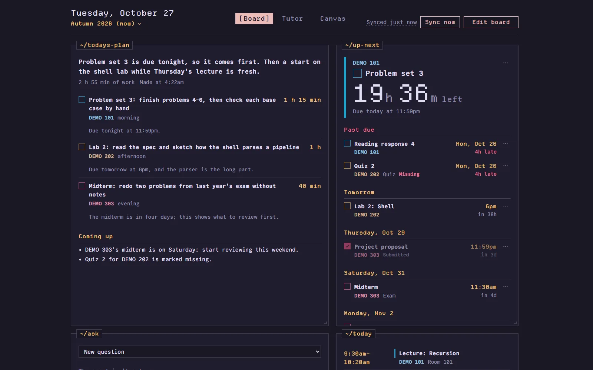
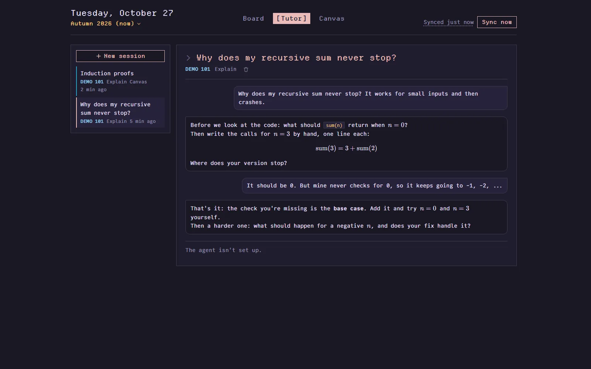
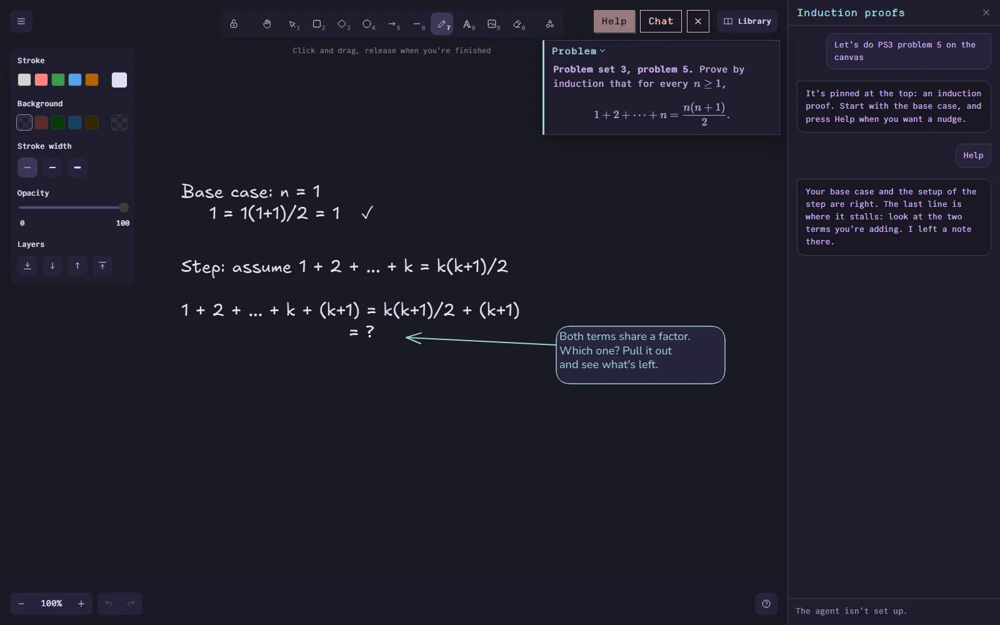

# School dashboard

What's due across Canvas, Gradescope and UW CSE course calendars, on one self-hosted page
that's reachable only over Tailscale. An agent that has read your course materials makes a
plan for each day, writes briefs for upcoming assignments, and tutors you, in chat or on a
whiteboard you share with it.

I built it for my own courses at the University of Washington, so the sources speak UW's Canvas,
Gradescope and CSE course sites, but any iCalendar feed works, and a new source is one module.

## Screenshots

All from the demo (made-up courses and data, see below).



| | |
|---|---|
|  |  |

## Try the demo

```bash
cd frontend && npm install && npm run build && cd ..
cd backend
python -m venv .venv
.venv/bin/pip install -e .           # Windows: .venv\Scripts\pip
.venv/bin/python -m app.demo         # http://localhost:8765
```

Every course, deadline, grade and message in the demo is made up: three courses (DEMO 101, 202 and
303), a day's plan, a tutoring session, and a whiteboard partway through a proof. It reads no `.env` or `config.yaml`, never contacts
Canvas or Gradescope, and runs without the agent, so planning, questions and new tutoring messages
say the agent isn't set up. Its data goes to a temp folder that's deleted when you stop it with
Ctrl+C; set `SCHOOL_DEMO_DATA` to keep it somewhere else (the demo refuses a folder that already
holds other data). Skip the frontend build and it serves the API only; run `npm run dev` in
`frontend/` and open http://localhost:5173 instead.

## How it works

```
canvas feed ──┐                     ┌─────────────── docker compose ───────────────┐
gradescope ───┤                     │                                              │
cse calendars ┼──▶ source adapters ─┼▶ SQLite ◀─ FastAPI ─ React UI                │
any .ics ─────┘   (backend/app/     │  (dedupe,   │   ▲                          │
                   sources/)        │   grades)   │   └─ tailscale serve (HTTPS) ┼──▶ laptop / phone
course sites ─┐                     │             │                              │
canvas files ─┼──▶ library ─────────┼▶ data/library    snapshot, /ask            │
your uploads ─┘   (backend/app/     │      │              │                      │
                   library/)        │      ▼              ▼                      │
                                    │   agent container: prime-agent, read-only  │
                                    └──────────────────────────────────────────────┘
```

- **Sources** (`backend/app/sources/`) each fetch one place and return items in one shape:
  `kind`, `title`, `due_at` or `starts_at`, `course`, `status`. Sync upserts them by
  `(source, source_id)` and marks anything that disappeared inside the fetched window as removed.
- **Widgets** (`frontend/src/widgets/`) each send the same item query (time window, kinds,
  courses, sources, status) and differ only in how they draw the results.
- **Your state** lives apart from synced data, so syncs never overwrite it. That covers
  per-item done/hidden/pinned/note (`overlays` table) and the board's widgets, options
  and layout (`boards` table).

## Using the board

- Tick the circle next to anything due to mark it done. The **⋯** menu pins it to the top
  of Up next, adds a note, or hides it ("Show hidden items" at the bottom brings them back).
- Past due lists assignments you haven't ticked off. Canvas's feed doesn't say what you've
  submitted, so ticking is how you tell it.
- **Edit board** lets you drag widgets by their title bar, resize them from the corner, add
  more (the same widget can appear twice with different filters, such as one Up next per
  course), change each one's settings, or remove it. Changes save to the server, so
  your laptop and phone show the same board. On a phone, widgets stack in the desktop
  board's reading order.

## Today's plan, briefs and questions

The `agent` container runs prime-agent, an agent harness, with its own persistent
home (sessions and memory), a workspace with instructions (`AGENTS.md`) and helpers
(`school.py`), a read-only snapshot of the dashboard's database, and the course library,
read-only. It gets the Claude API key and nothing else: no cookies, no `.env`. The dashboard
asks it for three things:

- **Today's plan**, every morning at `planner.time` and whenever you press **Plan again** (where
  you can add a note: "only two hours today"). Two to six concrete tasks sized to the hours you
  have (`planner.hours`), each with why it's today's, steps, and links to the spec section,
  slides or textbook pages that help. Tick tasks off as you go; a re-plan knows what you've done.
- **Briefs**, from any assignment's **⋯** menu (**Brief and questions**), and each morning for
  assignments and exams due within `planner.brief_days` that don't have one: what it asks, what
  to read first (with pages), a plan of attack with time estimates, what to watch out for, and
  what to ask in office hours.
- **Questions**, in the **Ask** widget, or about one item from its menu.
- **Tutoring**, on the **Tutor** page (`/tutor`): sessions for one course and, optionally, one exam or
  assignment, in one of four modes: Ask, Explain (step by step, checking you follow), Quiz me (practice
  questions one at a time, with feedback) and Exam review (what it covers, a plan, practice on weak spots).
  Sessions are kept, so you can pick one up again later; math renders properly ($\LaTeX$). The camera
  button attaches photos of your handwritten work (up to four a message; on a phone it offers the camera),
  and the agent looks at them and gives feedback on practice problems. Photos are stored upright, at most
  1600 px, without their metadata (no location), in `data/uploads/`.
- **Working a problem by hand**, on the **Canvas** page (`/canvas`): an [Excalidraw](https://excalidraw.com)
  whiteboard you share with the tutor. Name the problem ("HW 3 problem 2") and it finds it in your course
  materials and pins it over the canvas, or attach a photo of it. Write your work with a pen or stylus;
  **Help** (or the chat beside the canvas) sends the tutor a snapshot of the whole canvas, and it answers
  with notes in teal next to the step in question, arrows and circles, plus a line in the chat. Notes are
  hints and questions, never the next step done for you. Canvases save as you draw (`data/canvases/` holds
  their images) and keep their conversations. Excalidraw's fonts are served from the dashboard itself.
  Any Tutor session can open a canvas too: the canvas button, above the camera in the reply box, opens it full
  screen with the session's chat beside it (`/tutor/<id>/canvas`; ✕ goes back), so you can work a quiz
  question or an example by hand. The session keeps its
  mode; Help and messages sent from there carry a snapshot, and the tutor can pin a problem over the
  canvas for you to work. Deleting the session deletes its canvas.

How it tutors follows TutorMoments ([Zhang et al., 2026](https://tutormoments.allen.ai/static/paper/tutormoments-preview.pdf)),
which found that LLM tutors left to their defaults over-scaffold (do the student's thinking) and rarely
push for rigor, and that spelling out the trade-off fixes most of it. So the agent's instructions put every
reply on one dial: scaffold, lightest support first, when you're stuck or holding a misconception; push for
rigor (why, a harder version, do it alone) when you're getting it right. It says plainly when an answer is
right, and once you've shown you understand what you came for, it sums up the takeaway and stops asking.
Explain sessions start from what you already know, quizzes get harder as you get them right, and exam reviews
test you before explaining anything. In a session, **I'm stuck**, **Harder one** and **Let me try alone** tell it
where you are in one tap. Briefs give a ready check and a work plan, never the problems broken into steps.

It's a reference and a planner, not a solver: its instructions follow the Allen School's "AI as
a Reference Tool" policy, so it explains, plans and points to material, and
won't write solutions or work assigned problems. On graded homework that's still open, it tells you
whether an answer you reached yourself is right, but not where a wrong one goes wrong or how to fix it.
Its citations (`doc:41#page=12`) open the document at that page. Each plan, brief and answer records
what it cost, and `/api/agent` totals the month.

It can also search the web, for what the library doesn't cover (tool docs, error messages, background),
if you give prime-agent a [Serper](https://serper.dev) key: run
`docker compose exec -w /workspace agent /opt/prime-agent/bin/prime-agent`, type `/mcp`, choose
**Serper (web search)** and paste the key, then `/quit`. The key stays in prime-agent's own settings in
`data/agent-home/`. The course library comes first, and it never searches for answers to graded work.

## The library

What the agent reads, under `data/library/`, with a text version of each file (PDF pages marked
`--- page N ---`) and an `INDEX.md` it starts from:

- **Course sites:** every course's `links.site` in config.yaml, plus any `library.sites`: the
  pages, the PDFs and text files they link (lecture slides prefer the inked versions), and the
  Google Slides and Docs they link, when those are shared publicly.
- **Canvas** (with the `canvas` source set up): syllabi, assignment descriptions, pages, and the
  files that modules, pages and descriptions link to. It uses the canvas source's session
  cookie, so it stops when that expires, like the source does.
- **Yours:** **Add to library** in the Library widget takes PDF, Word, PowerPoint and text files,
  several at once or a whole folder (each titled by its path in it; hidden folders like `.git` are
  left out), or pasted text: your textbook, lab specs from the course repository, notes on what an
  exam covers.

The library is read a minute after the server starts and every `library.interval_hours`;
unchanged files aren't downloaded again.

## Run it locally

```bash
cd backend
python -m venv .venv
.venv/bin/pip install -e ".[dev]"     # Windows: .venv\Scripts\pip
.venv/bin/python dev.py               # API on :8765, using config.dev.yaml
```

```bash
cd frontend
npm install
npm run dev                           # http://localhost:5173
```

`dev.py` uses your `config.yaml` (with secrets from `.env`) if you've made one. Otherwise it
falls back to `config.dev.yaml`: made-up demo items, no accounts needed. Run the tests with `.venv/bin/python -m pytest` in `backend/`. There's no agent locally
unless you set `AGENT_URL` to a running runner (`python -m app.agent.runner`, which needs
prime-agent and `ANTHROPIC_API_KEY`).

## Deploy on a home server

1. In the Tailscale admin console, turn on MagicDNS and HTTPS certificates (the DNS page),
   then create an auth key (Settings → Keys → Generate auth key; not reusable, not
   ephemeral). The key is required: without one the container prints a login link but
   gives up on it after about a minute and starts over with a new one.
2. `cp .env.example .env` and fill in `TS_AUTHKEY` and `CANVAS_FEED_URL`, and for the agent
   `ANTHROPIC_API_KEY`, `PRIME_AGENT_DIR` (where prime-agent is installed) and your `PUID`/`PGID`.
3. `cp config.example.yaml config.yaml` and edit it (your section, course colors, your hours).
4. `mkdir -p data/agent-home data/agent-workspace data/snapshot data/library data/uploads` (so these are
   yours, not root's), then `docker compose up -d --build`.
5. Open `https://school.<your-tailnet>.ts.net`. On your phone, use Share → Add to Home
   Screen to get it as an app.

After editing `config.yaml`, run `docker compose restart app`. After changing `.env`, run
`docker compose up -d` (a restart doesn't re-read it). To update, pull and run
`docker compose up -d --build`. No port is published on the host: if a device isn't on
your tailnet, it can't reach the dashboard. In the admin console, turn off key expiry for
the `school` machine, or it drops off your tailnet after 180 days.

Everything the dashboard keeps is in `data/`: the database (`dashboard.db`), the library, and
the agent's home and workspace. That's the folder to back up.

## Where the data comes from

| Source type | What it reads | Notes |
|---|---|---|
| `canvas_feed` | Canvas → Calendar → **Calendar Feed** link | Every course's due dates. No token needed. No submission status. |
| `cse_calendar` | A CSE course's `calendar/calendar-<name>.ics` feeds (linked from `subscribe.html`) | Understands createcal's event types. Builds IDs from content because createcal regenerates UIDs on every rebuild. |
| `ics` | Any iCalendar URL or file | Use `id_from: content` for feeds whose UIDs change between rebuilds. |
| `gradescope` | Your Gradescope course pages | Scores, submitted/missing, and exact due and late-due times. Login is NetID-only, so it uses a browser `Cookie` header, which expires. |
| `canvas` | Canvas REST API | Every assignment with your score, status and assignment group. UW doesn't issue tokens, so it accepts a browser `Cookie` header, which expires. |
| `demo` | Nothing | Made-up items, some graded, for trying the UI. |

The sync status in the header shows each source's last run and any error.

### Getting a session cookie (Gradescope, Canvas API)

Open the site logged in, then open DevTools → Network and reload. Click the request for the page
itself (`www.gradescope.com`), find **Request Headers → cookie**, copy its whole value, and paste it
into `.env` (`GRADESCOPE_COOKIE=...`). It's as powerful as your login, so keep `.env` private. The
dashboard only reads pages with it. When the session expires, the header says the source isn't
syncing; paste a fresh one and run `docker compose restart app`.

## The same assignment from several sites

Canvas, Gradescope and a course calendar often list the same homework. The dashboard shows one
item when they're in the same course and either share an id (Canvas's API and its calendar feed
do), or have titles naming the same work ("HW3" and "Homework 3"; not "Lab 2 Part 1" and "Lab 2
Part 2") due within a day and a half of each other. The merged item takes the most informative
status (graded beats submitted beats missing), the timed due date over a calendar's all-day one,
and the score from whoever has it. Its **⋯** menu links to each site's copy, and offers
**Keep these separate** when two things were wrongly merged. Marking a merged item done, pinned
or hidden applies to every copy, so the mark survives if the match changes later.

## Grade estimates

Give a course `grading.categories` in `config.yaml` (see `config.example.yaml`). Each graded item
goes to the category matching its title (or its Canvas assignment group), and the **Grades**
widget weights the categories that have grades so far. It says how much of the course grade
that covers, since early in the quarter an estimate can rest on a small share. Courses
without weights get a plain points total. Scores come from Gradescope and the Canvas API source.

## Quarters

Every course belongs to a quarter: Canvas's term ("Autumn 2026"), Gradescope's ("Fall 2026") or a
course site's address (`.../cse410/26au/`) says which, and for a course none of them place, its
dates do. The dashboard opens on today's quarter. Between quarters, before the next quarter's
courses appear anywhere, it stays on the last one.

The picker under the date shows another quarter for the rest of that browser tab: its courses,
grades, library and tutoring sessions. Deadlines, the calendar and today's plan are always about
now, so a past quarter leaves them empty. A notice says which quarter you're looking at, with a
way back.

When a new quarter starts, Canvas and Gradescope pick up the new courses on their own. In
config.yaml, add each new course's links and grading weights, and a `cse_calendar` source for
each new course site; last quarter's entries can stay. Give a course `quarter: 27wi` only if
nothing else places it. Course colors go to the current quarter's courses first.

## Adding a source

Write a module in `backend/app/sources/` and import it in `sources/__init__.py`:

```python
class MyConfig(BaseModel):
    url: str

@register
class MySource(Source[MyConfig]):
    type = "my_source"          # what config.yaml's `type:` refers to
    Config = MyConfig           # validated from that entry's other keys
    default_interval = timedelta(hours=1)

    async def fetch(self, ctx: SourceContext) -> FetchResult:
        ...
        return FetchResult(items=[ItemIn(source_id=..., kind="assignment", title=..., due_at=...)])
```

`source_id` must stay the same across syncs: it's how the dashboard recognizes an item it has
seen before, and later how your done/notes state stays attached to it.

## Adding a widget

Write a component in `frontend/src/widgets/` that takes `{ options }`, then add an entry to
`widgets/registry.tsx` with its defaults, default size, and `fields`, the list its settings
form is generated from. It then shows up under Add widget. Overlay actions (`DoneToggle`,
`ItemMenu`, `NoteLine` in `frontend/src/items/`) work in any widget.

## Roadmap

1. **Skeleton:** Canvas feed, CSE calendars, Up next, Today, Docker + Tailscale. *(done)*
2. **Your state and the grid:** mark done/hide/pin/notes, drag-and-drop layouts saved on
   the server, week view, course cards. *(done)*
3. **Grades and Gradescope:** Gradescope adapter (session cookie, since login is NetID-only),
   dedupe across sources, grade estimates from course weights. *(done)*
4. **The agent:** course library, daily plan, assignment briefs, questions. *(done)*
5. **Tutoring:** Tutor sessions, the shared canvas, and a [replay evaluation](eval/tutoring/) of
   the tutoring guidance against TutorMoments. *(done)*
6. **Later:** Ed announcements, notifications, workload heatmap.

## Built with

- **Backend:** Python, [FastAPI](https://fastapi.tiangolo.com) and Uvicorn, SQLAlchemy on SQLite, Pydantic,
  httpx, [icalendar](https://github.com/collective/icalendar) and recurring-ical-events for the calendar
  feeds, Beautiful Soup and markdownify for course sites, [PyMuPDF](https://pymupdf.readthedocs.io) for PDFs
  and page images, Pillow for photos.
- **Frontend:** React and TypeScript on Vite, TanStack Query, react-grid-layout for the board,
  react-markdown with [KaTeX](https://katex.org) for math, and [Excalidraw](https://github.com/excalidraw/excalidraw)
  for the shared canvas.
- **The agent:** prime-agent, an agent harness, running Claude (Opus) with a Python kernel and the
  course library, and optionally [Serper](https://serper.dev) for web search.
- **Hosting:** Docker Compose and [Tailscale](https://tailscale.com) (`tailscale serve`, no open ports).
- **Look:** the [Rosé Pine](https://rosepinetheme.com) palette, Departure Mono and CommitMono.
- **Evaluation:** [TutorMoments](https://github.com/allenai/tutormoments) (Allen AI) replays.

## License

MIT, see [LICENSE](LICENSE). The bundled fonts are under the SIL Open Font License 1.1
([frontend/src/fonts/](frontend/src/fonts/)); the whiteboard is [Excalidraw](https://github.com/excalidraw/excalidraw) (MIT).
